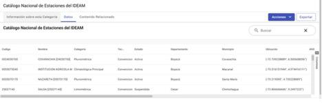
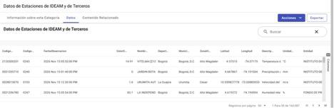
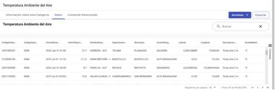

# Punto 1 – Caso de estudio

**Objetivo:** plantear un caso con datos en tres tipos de fuente (base de datos, archivos y URL) y al menos cinco preguntas de negocio.

## Caso

El IDEAM publica en [datos.gov.co](https://www.datos.gov.co) las mediciones de su red de estaciones meteorológicas. El caso analiza la **temperatura del aire en Colombia entre abril y junio de 2025** para entender cómo cambia según el lugar, la altitud, el mes y la hora, y qué tan completa es la información que reporta cada estación.

## Datasets

| Dataset | ID | Filas | Contenido | Fuente en el proyecto |
|---|---|---|---|---|
| [Catálogo Nacional de Estaciones del IDEAM](https://www.datos.gov.co/Ambiente-y-Desarrollo-Sostenible/Cat-logo-Nacional-de-Estaciones-del-IDEAM/hp9r-jxuu/about_data) | `hp9r-jxuu` | 38.782 | Código, nombre, categoría, tecnología, estado, departamento, municipio, altitud y coordenadas de cada estación | Base de datos (RDS MariaDB) |
| [Temperatura Ambiente del Aire](https://www.datos.gov.co/Ambiente-y-Desarrollo-Sostenible/Temperatura-Ambiente-del-Aire/sbwg-7ju4/about_data) | `sbwg-7ju4` | 1.453.127 (abr–jun 2025) | Temperatura en °C por estación y hora | Archivo CSV en una EC2 |
| [Datos de Estaciones de IDEAM y de Terceros](https://www.datos.gov.co/Ambiente-y-Desarrollo-Sostenible/Datos-de-Estaciones-de-IDEAM-y-de-Terceros/57sv-p2fu/about_data) | `57sv-p2fu` | ~160.000 | Variables meteorológicas recientes (viento, lluvia, humedad, temperatura...) | URL (API Socrata) |

Los tres comparten el **código de estación**, lo que permite unirlos.

### Decisiones

- **Periodo de tres meses** (abril a junio de 2025): suficiente para que Spark tenga sentido (≈1,45 millones de filas) y pequeño para el Learner Lab.
- Se descartó el dataset `cqmv-a99d` porque es un subconjunto redundante del catálogo.
- Cada dato va al formato que le corresponde: referencia estable a base de datos, histórico grande a archivo, dato cambiante a la URL.

## Preguntas de negocio

1. ¿Qué departamentos tienen la temperatura promedio más alta y más baja en el periodo?
2. ¿Cuál fue el municipio más caliente y cuál el más frío?
3. ¿Cómo varía la temperatura promedio mes a mes (abril, mayo y junio de 2025)?
4. ¿Cómo cambia la temperatura a lo largo del día (por hora)?
5. ¿Qué relación hay entre la altitud de la estación y su temperatura promedio? *(une con el catálogo)*
6. ¿Qué categorías o tecnologías de estación aportan más mediciones? *(une con el catálogo)*
7. ¿Qué estaciones reportaron menos mediciones y qué características tienen (categoría, tecnología, departamento)? *(une con el catálogo)*

Las respuestas están en [06_consultas_sql](../06_consultas_sql/README.md#respuestas-a-las-preguntas-de-negocio).

## Evidencias

| Captura | Qué muestra |
|---|---|
|  | Catálogo Nacional de Estaciones del IDEAM en datos.gov.co |
|  | Datos de Estaciones de IDEAM y de Terceros |
|  | Temperatura Ambiente del Aire |
