# Punto 2 – Fuentes de datos

**Objetivo:** tener datos en una base **RDS MariaDB**, en **archivos dentro de una EC2** y en una **URL** de Internet.

## Qué hay en esta carpeta

| Archivo | Para qué |
|---|---|
| `infra/01_red.sh` | Crea los grupos de seguridad: `fuente-archivos-sg` (EC2, sin entrada) y `rds-mariadb` (acepta 3306 solo desde la EC2) |
| `infra/02_ec2.sh` | Lanza la EC2 `fuente-archivos` (Amazon Linux 2023, `t3.micro`, `LabInstanceProfile`) con `setup_ec2.sh` como *user data* |
| `infra/03_rds.sh` | Crea la RDS `bd-estaciones` (MariaDB 11.8, `db.t3.micro`, privada) con la base `ideam`; pide la clave maestra por teclado |
| `setup_ec2.sh` | Se ejecuta al arrancar la EC2: instala el cliente MariaDB y cron, y baja los scripts del repo a `~/datos` |
| `my.cnf.ejemplo` | Plantilla de `~/.my.cnf` (host, usuario y clave de RDS) para no dejar credenciales en el repo |
| `descargar_temperatura.sh` | Baja la temperatura de abr–jun 2025 de la API, un día a la vez, y la une en un CSV |
| `descargar_catalogo.sh` | Baja el catálogo de estaciones a `estaciones.csv` |
| `cargar_catalogo.sql` | Crea la tabla `estaciones` en RDS y la llena con ese CSV |

## Cómo reproducir

Desde la terminal del Learner Lab (o CloudShell), con `.env` creado en la raíz del repo:

```bash
bash 02_fuentes_datos/infra/01_red.sh
bash 02_fuentes_datos/infra/02_ec2.sh
bash 02_fuentes_datos/infra/03_rds.sh      # imprime el endpoint de la RDS
```

Luego entrar a la EC2 (consola → EC2 → Conectar → Session Manager) y, como `ec2-user` (`sudo su - ec2-user`):

```bash
cd ~/datos
cp my.cnf.ejemplo ~/.my.cnf && nano ~/.my.cnf && chmod 600 ~/.my.cnf   # endpoint y clave de RDS
bash descargar_temperatura.sh        # ~250 MB, unos minutos
bash descargar_catalogo.sh           # Filas: 38782
mysql --ssl --local-infile=1 < cargar_catalogo.sql    # filas = 38782, estaciones_distintas = 18446
```

La fuente **URL** no se guarda: es la API `https://www.datos.gov.co/resource/57sv-p2fu.csv`, y la consulta `ingesta.sh` (punto 3) en cada corrida.

## Decisiones y detalles

- **RDS privada**: sin acceso público; solo la EC2 entra por el puerto 3306 (regla por grupo de seguridad, no por IP).
- **Cifrado obligatorio**: RDS MariaDB 11.8 exige TLS, por eso el cliente usa `--ssl`.
- **Descarga por días**: pedir tres meses de golpe a la API es lento y falla; se hace un día por petición (~18.000 filas) y se concatenan.
- **El catálogo se carga tal cual** (zona raw): sin llave primaria sobre `codigo`, porque la fuente repite cada estación 2 o 4 veces (38.782 filas, 18.446 códigos distintos, ~9.935 estaciones reales). La limpieza se hace en el punto 4.
- Se quitó la columna `ubicaci_n` del catálogo: trae saltos de línea que rompen el CSV y repite latitud y longitud.
- **Hallazgo de calidad:** la fuente no tiene datos para varios días de finales de mayo y principios de junio de 2025 (la API responde sin filas). Se documenta como limitación.

## Evidencias

### Preparación del entorno

| Captura | Qué muestra |
|---|---|
| 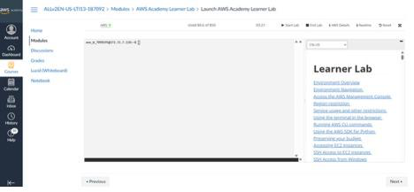 | Learner Lab iniciado |
| 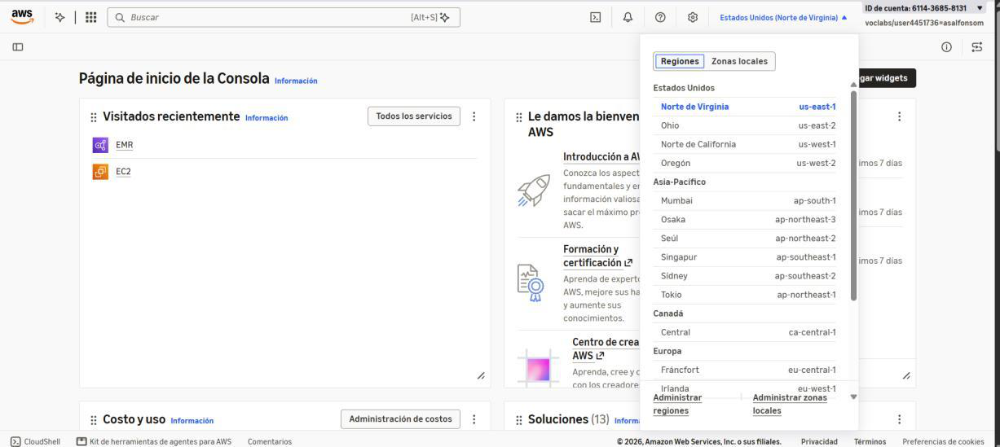 | Consola de AWS en `us-east-1` |
| 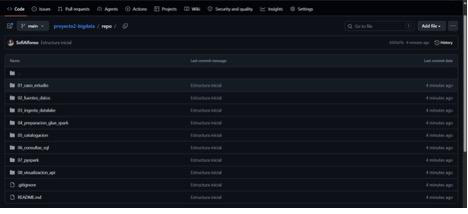 | Repositorio de GitHub con las carpetas de cada punto |

### Archivos (EC2)

| Captura | Qué muestra |
|---|---|
| 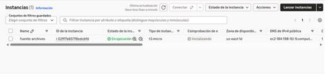 | Instancia `fuente-archivos` en ejecución |
| 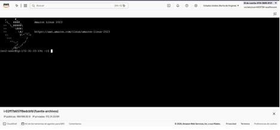 | Terminal conectada a la EC2 |
| 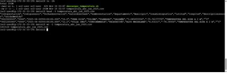 | CSV de temperatura descargado (251 MB, 1.453.128 líneas) |

### Base de datos (RDS MariaDB)

| Captura | Qué muestra |
|---|---|
| 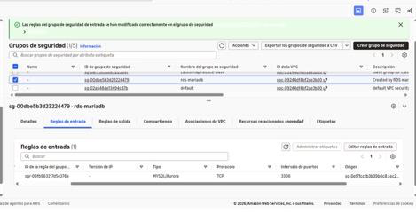 | Regla de seguridad: 3306 solo desde la EC2 |
| 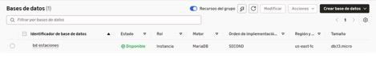 | Base `bd-estaciones` disponible |
| 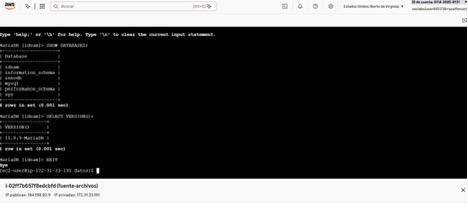 | Conexión desde la EC2 (`SHOW DATABASES`, versión 11.8.9) |
| 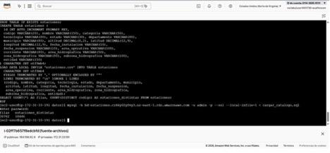 | Carga del catálogo: 38.782 filas, 18.446 códigos distintos |

### URL

| Captura | Qué muestra |
|---|---|
| 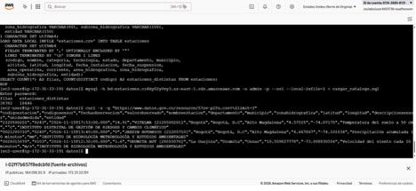 | `curl` a la API desde la EC2 con filas recientes |
