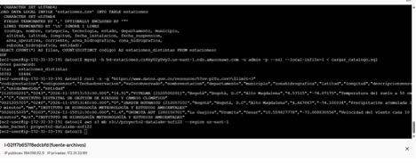
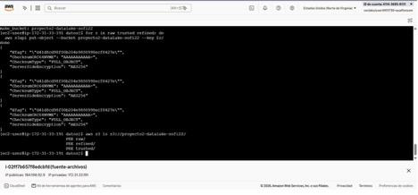
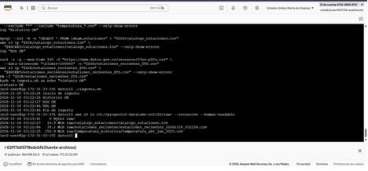
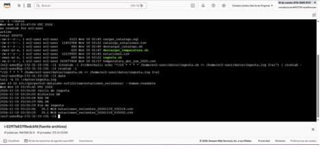

# Punto 3 – Ingesta al data lake (S3)

**Objetivo:** llevar las tres fuentes al data lake en **S3**, en las zonas correctas y con un **proceso automático**.

## Qué hay en esta carpeta

| Archivo | Para qué |
|---|---|
| `crear_bucket.sh` | Crea el bucket `BUCKET_NAME` (de `.env`) con las zonas `raw/`, `trusted/` y `refined/` |
| `ingesta.sh` | Lee las tres fuentes y deja los datos en `raw/` |
| `programar_ingesta.sh` | Corre `ingesta.sh` una vez y lo programa en cron |

## Estructura del data lake

```
s3://<BUCKET_NAME>/
├── raw/
│   ├── catalogo_estaciones/      ← desde RDS (TSV)
│   ├── temperatura_historica/    ← desde el CSV de la EC2
│   └── estaciones_recientes/     ← desde la API (un archivo por corrida)
├── trusted/                      ← punto 4
└── refined/                      ← punto 8
```

## Cómo reproducir

```bash
# Desde la terminal del lab (con .env creado):
bash 03_ingesta_datalake/crear_bucket.sh

# En la EC2, como ec2-user, cuando ya existen ~/.my.cnf y el CSV de temperatura:
bash ~/datos/programar_ingesta.sh
```

`ingesta.sh` lee el bucket de `~/datos/.env` (lo crea `setup_ec2.sh`; en una EC2 hecha a mano: `echo "BUCKET_NAME=<bucket>" > ~/datos/.env`).

## Cómo funciona `ingesta.sh`

1. **Archivos:** `aws s3 sync` sube el CSV histórico solo si todavía no está en S3 (evita resubir 251 MB en cada corrida).
2. **Base de datos:** exporta la tabla `ideam.estaciones` con `mysql -B` (TSV) y la sube. Cada corrida reemplaza el archivo.
3. **URL:** descarga la ventana reciente de la API con la hora en el nombre del archivo, la sube y borra la copia local. Cada corrida agrega un archivo nuevo.

El script usa `set -e`: si una etapa falla, se detiene y no sube archivos dañados. Las credenciales de RDS están en `~/.my.cnf`, nunca en el script. El permiso para escribir en S3 viene del perfil `LabInstanceProfile` de la EC2, sin claves.

## Automatización

`programar_ingesta.sh` deja en cron:

```
*/10 * * * * /home/ec2-user/datos/ingesta.sh >> /home/ec2-user/datos/ingesta.log 2>&1
```

Corre en los minutos 0, 10, 20... de cada hora (hora UTC) y deja la salida en `ingesta.log`. Se usó cada 10 minutos para tener evidencia de varias ejecuciones sin esperar; para un uso normal conviene bajarlo a cada hora (`0 * * * *`), porque la API a veces no cambia entre corridas y cada una agrega ~39 MB.

El cron solo corre mientras la EC2 esté encendida; el Learner Lab la detiene al terminar la sesión y la ingesta se reanuda al encenderla.

## Evidencias

| Captura | Qué muestra |
|---|---|
|  | Creación del bucket |
|  | Zonas `raw/`, `trusted/` y `refined/` |
|  | Ejecución manual de `ingesta.sh` y archivos en `raw/` |
|  | `crontab -l`, log con corridas automáticas y varios archivos en `estaciones_recientes/` |
