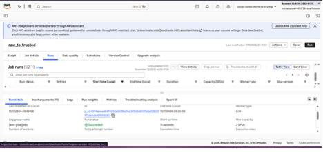
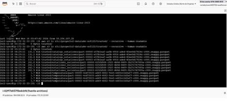
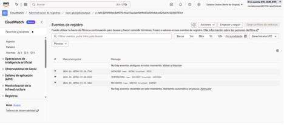

# Punto 4 – Preparación de datos (raw → trusted)

**Objetivo:** limpiar los datos crudos con **AWS Glue y Apache Spark** y guardarlos en la zona `trusted/` en formato **Parquet**.

## Qué hay en esta carpeta

| Archivo | Para qué |
|---|---|
| `raw_to_trusted.py` | Script PySpark del job de Glue |
| `crear_job_glue.sh` | Sube el script a S3, crea el job `raw_to_trusted` (Glue 4.0, `G.1X`, 2 workers, `LabRole`) y lo ejecuta hasta que termina |

## Cómo reproducir

Con la zona `raw/` ya poblada (punto 3):

```bash
bash 04_preparacion_glue_spark/crear_job_glue.sh
```

El bucket llega al job como argumento `--BUCKET_NAME` (lo toma de `.env`). Si el job se crea a mano en la consola, hay que agregar ese parámetro en *Job details → Job parameters*.

## Reglas de limpieza

| Conjunto | Reglas |
|---|---|
| **Catálogo** | Código de estación a 10 dígitos (`lpad`) · altitud, latitud y longitud a número · fechas `dd/MM/yyyy` a fecha · vacíos a nulo · departamento y municipio en MAYÚSCULAS sin tildes (Bogotá siempre `BOGOTA D.C.`) · **una fila por estación** (se prefiere la fila con código original de 10 dígitos) |
| **Temperatura histórica** | Valor a número y fecha a *timestamp* · se descartan nulos y valores fuera de -10 a 45 °C · columnas `anio`, `mes`, `dia` y `hora` · textos normalizados · duplicados fuera (estación + fecha + sensor) |
| **Estaciones recientes** | Mismas conversiones, sin filtro de rango (hay muchas variables con escalas distintas) · se juntan todos los archivos de las corridas y se quitan los duplicados |

### Por qué estas reglas

- El catálogo tiene la misma estación con el código de **8 y de 10 dígitos**, y repetida; sin normalizar el código no se pueden unir las fuentes (con la regla, las 242 estaciones de una muestra de temperatura encontraron su par).
- Los nombres de departamento vienen en mayúsculas y sin tildes en la temperatura y con tilde en el catálogo.
- Los textos vacíos pasan a nulos y todo viene como texto: se tipan los números y las fechas.
- La API de datos recientes repite observaciones entre corridas.

## Resultados

| Conjunto | Antes (raw) | Después (trusted) |
|---|---|---|
| Catálogo de estaciones | 38.782 | **9.935** |
| Temperatura histórica | 1.453.127 | **1.453.114** (13 descartadas) |
| Estaciones recientes | 481.761 (3 archivos de 160.587) | **160.587** (los 3 archivos eran idénticos) |

La temperatura pasa de 251 MB en CSV a unos 7 MiB en Parquet (compresión por columnas).

## Evidencias

| Captura | Qué muestra |
|---|---|
|  | Ejecución del job `raw_to_trusted` en estado *Succeeded* |
|  | Archivos Parquet en `trusted/` |
|  | Conteos antes y después de limpiar, en CloudWatch |

> Pendiente de capturar para completar este punto: la pestaña *Script* o *Job details* del job en la consola de Glue.
