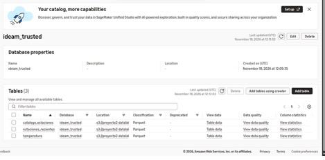
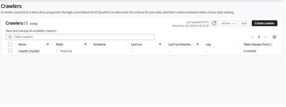
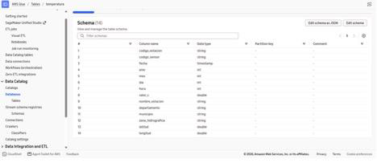
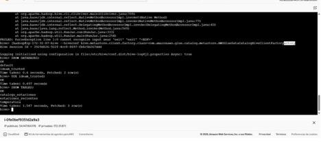
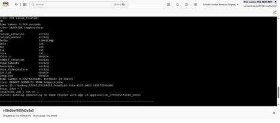

# Punto 5 – Catalogación de tablas

**Objetivo:** registrar los datos de `trusted/` como tablas SQL con **AWS Glue** y **EMR/Hive**.

Los archivos Parquet de `trusted/` son solo archivos sueltos. Un **catálogo** es el índice que le dice a las herramientas SQL "en esta carpeta hay una tabla con estas columnas y estos tipos".

## Qué hay en esta carpeta

| Archivo | Para qué |
|---|---|
| `crear_crawler.sh` | Crea la base `ideam_trusted` en el Catálogo de Datos de Glue y el crawler `crawler_trusted`; lo ejecuta y lista las tablas |
| `crear_emr.sh` | Crea el clúster EMR `cluster-ideam` (un nodo, Hadoop + Hive + Spark) con el catálogo de Glue como metastore |
| `ejecutar_hive.sh` | Ejecuta un archivo `.hql` en el clúster como un *step* y muestra la salida, sin entrar por SSH |
| `verificar_hive.hql` | Comprueba desde Hive que existen las 3 tablas y cuenta las filas de `temperatura` |

## Cómo reproducir

```bash
bash 05_catalogacion/crear_crawler.sh
bash 05_catalogacion/crear_emr.sh                                        # ~10 minutos hasta WAITING
bash 05_catalogacion/ejecutar_hive.sh 05_catalogacion/verificar_hive.hql
```

Resultado esperado: tres tablas (`catalogo_estaciones`, `estaciones_recientes`, `temperatura`) y `1453114` filas en `temperatura`.

## Glue: el crawler

Un *crawler* recorre una carpeta de S3, lee los archivos y deduce las tablas y sus columnas. `crawler_trusted` apunta a las tres carpetas de `trusted/` y crea una tabla por carpeta, todas con clasificación **Parquet**. Los tipos (`string`, `timestamp`, `int`, `double`) son los que dejó la limpieza del punto 4.

## EMR/Hive

- **Diseño:** un solo nodo `m5.xlarge`, porque los datos pesan unos 7 MiB en Parquet y un clúster de varios nodos solo agregaría costo. Se apaga solo tras 1 hora sin uso (`--auto-termination-policy IdleTimeout=3600`).
- **Metastore en Glue:** para que Hive y Spark vean las tablas de `ideam_trusted` hay que configurar la propiedad `hive.metastore.client.factory.class` con `com.amazonaws.glue.catalog.metastore.AWSGlueDataCatalogHiveClientFactory`. `crear_emr.sh` lo hace al crear el clúster, en las clasificaciones `hive-site` y `spark-hive-site`:

```json
[
  {"Classification": "hive-site",
   "Properties": {"hive.metastore.client.factory.class": "com.amazonaws.glue.catalog.metastore.AWSGlueDataCatalogHiveClientFactory"}},
  {"Classification": "spark-hive-site",
   "Properties": {"hive.metastore.client.factory.class": "com.amazonaws.glue.catalog.metastore.AWSGlueDataCatalogHiveClientFactory"}}
]
```

Si se crea el clúster desde la consola y no se pega este JSON en *Configuración de software*, Hive solo ve la base `default`; en ese caso se arregla arrancando `hive --hiveconf hive.metastore.client.factory.class=com.amazonaws.glue.catalog.metastore.AWSGlueDataCatalogHiveClientFactory`.

## Evidencias

| Captura | Qué muestra |
|---|---|
|  | Base `ideam_trusted` con sus 3 tablas Parquet en el Catálogo de Glue |
|  | Crawler `crawler_trusted` (3 tablas creadas) |
|  | Esquema de la tabla `temperatura` (14 columnas) |
|  | Hive ve `ideam_trusted` y sus 3 tablas |
|  | `DESCRIBE temperatura` en Hive |
|  | `SELECT COUNT(*)` en Hive: 1.453.114 filas |

> Pendiente de capturar para completar este punto: la consola de EMR con la configuración del clúster (versión, aplicaciones y un nodo).
