# Punto 6 – Consultas SQL (Athena, Hive y SparkSQL)

**Objetivo:** responder las preguntas de negocio con **SQL** sobre las tablas de `ideam_trusted`, usando **AWS Athena**, **EMR/Hive** y **SparkSQL**.

## Qué hay en esta carpeta

| Archivo | Para qué |
|---|---|
| `consultas.sql` | Las 8 consultas (Q1, Q2a, Q2b, Q3 a Q7), escritas en SQL estándar para que corran igual en las tres herramientas |
| `ejecutar_emr.sh` | Ejecuta un archivo en el clúster EMR con `hive`, `spark-sql` o `pyspark` y muestra la salida |

## Cómo reproducir

```bash
# Hive y SparkSQL en el clúster EMR (punto 5):
bash 06_consultas_sql/ejecutar_emr.sh hive      06_consultas_sql/consultas.sql
bash 06_consultas_sql/ejecutar_emr.sh spark-sql 06_consultas_sql/consultas.sql
```

En **Athena**: consola → Athena → editor de consultas; en *Configuración* poner como ubicación de resultados `s3://<BUCKET_NAME>/athena-results/`; elegir el origen `AwsDataCatalog` y la base `ideam_trusted`, y pegar cada consulta de `consultas.sql`.

`ejecutar_emr.sh` pasa `--database ideam_trusted` y `hive.cli.print.header=true`, por eso las consultas no traen el nombre de la base. La salida queda también en `s3://<BUCKET_NAME>/emr-salidas/`.

## Las consultas

| Id | Pregunta | Técnica |
|---|---|---|
| Q1 | Departamentos por temperatura promedio | `GROUP BY`, `AVG`, `ORDER BY` |
| Q2a / Q2b | 10 municipios más cálidos / más fríos (≥ 100 mediciones) | `HAVING`, `LIMIT` |
| Q3 | Temperatura mes a mes y días con datos | `MIN`, `MAX`, `COUNT(DISTINCT)` |
| Q4 | Temperatura por hora del día | `GROUP BY hora` |
| Q5 | Altitud vs. temperatura | `JOIN` con el catálogo, `CASE`, subconsulta |
| Q6 | Categorías y tecnologías con más mediciones | `JOIN`, `GROUP BY` |
| Q7 | 10 estaciones con menos mediciones | `JOIN`, `ORDER BY ... LIMIT` |

Las tres herramientas devuelven **los mismos resultados**, lo que sirve de comprobación cruzada.

## Respuestas a las preguntas de negocio

Periodo abril–junio de 2025, 1.453.114 lecturas de temperatura.

**1. Departamentos.** Los más cálidos: Bolívar (28,88 °C), Cesar (28,58), Archipiélago de San Andrés (28,55), Córdoba (28,31) y Magdalena (28,23). Los más fríos: Arauca (3,24 °C), Nariño (12,78), Caldas (14,09), Boyacá (14,34) y Bogotá D.C. (14,46). El valor de Arauca viene de 1.836 mediciones, lo que equivale a una sola estación de alta montaña, así que no representa a todo el departamento.

**2. Municipios** (con al menos 100 mediciones). El más cálido: **El Carmen de Bolívar** (32,65 °C), seguido de Sabanalarga, Atlántico (29,89), Uribia (29,47), Fonseca (29,09) y Zona Bananera (28,90). El más frío: **Anzoátegui**, Tolima (1,88 °C), seguido de Saravena, Arauca (3,24), Silos (6,07), Socotá (6,68) y Villamaría (7,72).

**3. Mes a mes.**

| Mes | Temp. promedio (°C) | Mediciones | Días con datos |
|---|---|---|---|
| Abril | 22,34 | 551.035 | 30 |
| Mayo | 21,98 | 372.810 | 20 |
| Junio | 21,66 | 529.269 | 28 |

La temperatura baja levemente (0,68 °C entre abril y junio). Mayo tiene solo 20 días con datos y junio 28, por la ausencia de datos en la fuente, así que la comparación debe leerse con cuidado. El mínimo es 0,0 °C en los tres meses y el máximo llega a 45,0 en abril y mayo.

**4. Por hora.** El mínimo es 19,36 °C a la hora 10 y el máximo 25,85 °C a la hora 18; la amplitud diaria es de 6,49 °C. La temperatura sube entre las horas 12 y 18 y baja después. Como el pico cae a la hora 18, la columna `hora` parece estar en **UTC** (en Colombia serían las 13:00 y las 05:00).

**5. Altitud.** La temperatura baja de forma sostenida al subir la altitud de la estación:

| Rango de altitud | Estaciones | Temp. promedio (°C) |
|---|---|---|
| Menos de 500 m | 107 | 27,31 |
| 500 a 1.499 m | 74 | 21,61 |
| 1.500 a 2.499 m | 72 | 17,35 |
| 2.500 m o más | 71 | 12,86 |

Entre el rango más bajo y el más alto hay unos 14,5 °C de diferencia.

**6. Categorías y tecnologías.** Las **estaciones sinópticas principales** dominan: 14 estaciones con tecnología "automática con telemetría y convencional" aportan 595.980 mediciones, y otras 4 "con telemetría" aportan 208.923; juntas son el 55 % de todas las lecturas. Les siguen las climatológicas principales con telemetría (109 estaciones, 195.562 mediciones) y las "con telemetría, convencional" (86 estaciones, 186.011). Por estación, las sinópticas aportan unas 42.000 a 52.000 lecturas, frente a unas 1.800 de las climatológicas (aprox. una por hora), lo que sugiere que reportan con más frecuencia que la horaria.

**7. Estaciones con menos mediciones.** Las 10 con menos lecturas en los tres meses: San Lorenzo – AUT (Magdalena, 20), Puerto Lleras (Meta, 22), Páramo de Yerbabuena – AUT (Tolima, 27), El Tesoro IDEAM – AUT (Sucre, 36), Pie de Pato (Chocó, 37), Salitre – AUT (Cundinamarca, 42), Málaga 2 AUT (Santander, 57), Reserva Natural La Planada – AUT (Nariño, 87), Puerto Estrella – AUT (La Guajira, 128) y Aeropuerto Puratena – AUT (Boyacá, 143). Casi todas son climatológicas principales con telemetría; hay también una climatológica ordinaria convencional, una agrometeorológica y una pluviográfica convencional. Para comparar, una estación con lectura horaria completa tendría unas 2.180 lecturas, así que estas reportaron menos del 7 %.

## Evidencias

### Athena

| Captura | Qué muestra |
|---|---|
| 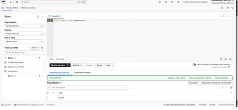 | `SELECT COUNT(*)`: 1.453.114 filas |
| 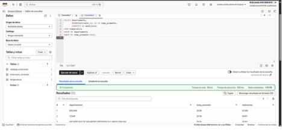 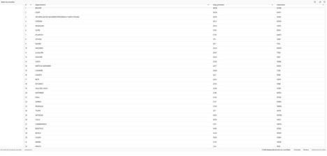 | Q1: departamentos |
| 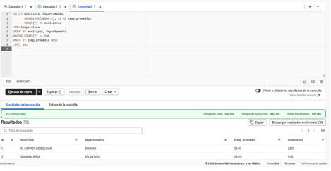 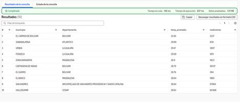 | Q2a: municipios más cálidos |
| 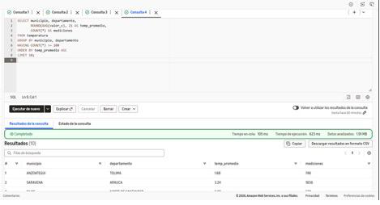 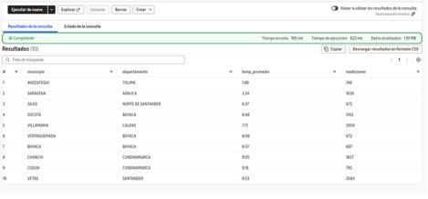 | Q2b: municipios más fríos |
| 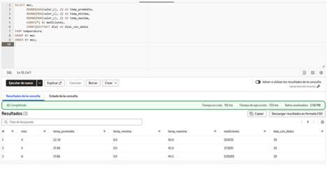 | Q3: mes a mes |
| 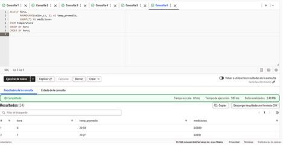 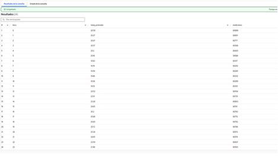 | Q4: por hora |
| 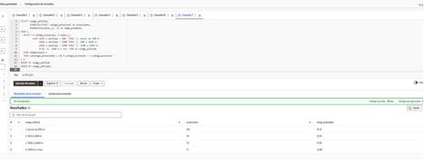 | Q5: altitud |
| 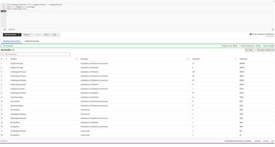 | Q6: categorías y tecnologías |
| 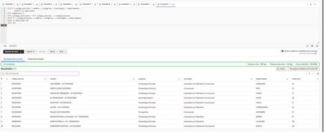 | Q7: estaciones con menos mediciones |

### Hive (EMR)

| Captura | Qué muestra |
|---|---|
| 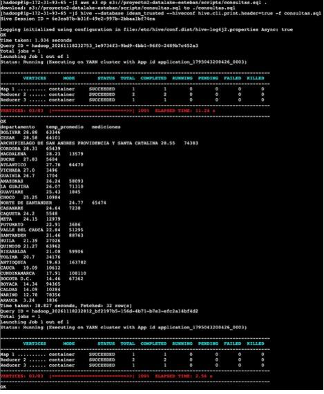 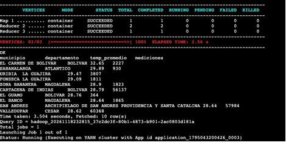 | Ejecución de `consultas.sql` con `hive -f`: Q1 y Q2a |
| 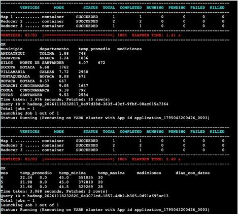 | Q2b y Q3 |
| 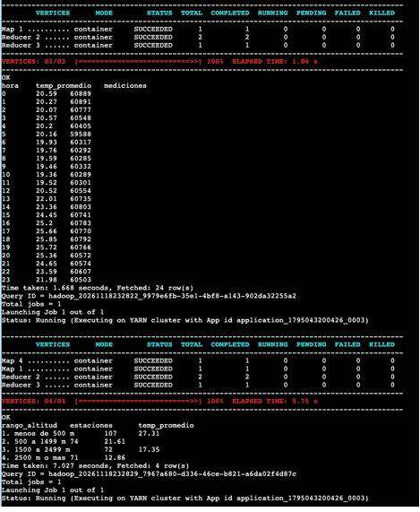 | Q4 y Q5 |
| 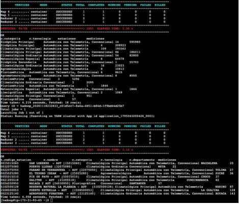 | Q6 y Q7 |

### SparkSQL (EMR)

| Captura | Qué muestra |
|---|---|
| 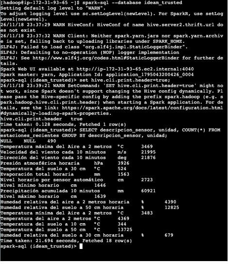 | Sesión interactiva de `spark-sql`: variables de `estaciones_recientes` agrupadas por sensor y unidad |
| 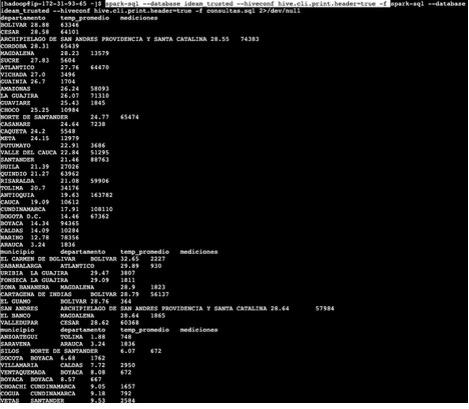 | `spark-sql -f consultas.sql`: Q1 y Q2 |
| 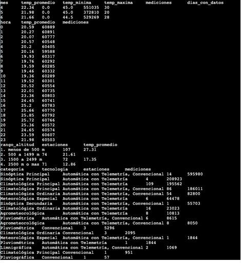 | Q3 a Q6 |
| 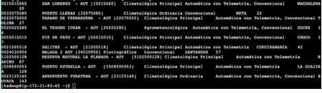 | Q7 |
