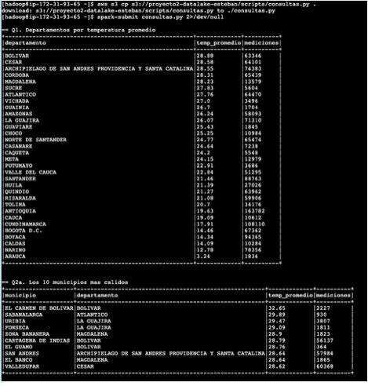
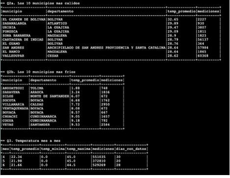
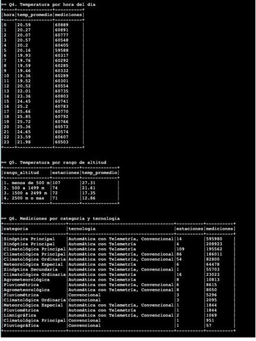
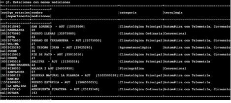

# Punto 7 – Análisis con PySpark

**Objetivo:** hacer el análisis descriptivo con **Spark en Python (PySpark)**, con la API de DataFrames.

## Qué hay en esta carpeta

| Archivo | Para qué |
|---|---|
| `consultas.py` | Las mismas 8 consultas de `06_consultas_sql/consultas.sql`, escritas con DataFrames de PySpark |

## Cómo reproducir

Con el clúster EMR en estado `WAITING` (punto 5):

```bash
bash 06_consultas_sql/ejecutar_emr.sh pyspark 07_pyspark/consultas.py
```

Ejecuta el script con `spark-submit` en el nodo principal y muestra la salida (también queda en `s3://<BUCKET_NAME>/emr-salidas/`).

## Cómo funciona

```python
spark = (SparkSession.builder.appName("consultas_pyspark")
         .enableHiveSupport()          # usa el catalogo de Glue configurado en el cluster
         .getOrCreate())

temp = spark.table("ideam_trusted.temperatura")
cat = spark.table("ideam_trusted.catalogo_estaciones")
```

Lee las tablas del catálogo de Glue igual que Athena, Hive y SparkSQL. Después cada consulta es una cadena de operaciones sobre DataFrames. Por ejemplo, Q1:

```python
q1 = (temp.groupBy("departamento")
          .agg(F.round(F.avg("valor_c"), 2).alias("temp_promedio"),
               F.count("*").alias("mediciones"))
          .orderBy(F.desc("temp_promedio")))
```

Equivale a `SELECT ... GROUP BY departamento ORDER BY temp_promedio DESC`. Las consultas Q5 a Q7 unen con el catálogo mediante `join("codigo_estacion")`. En Q7 se desempata por código para que el resultado no cambie entre corridas.

## Resultados

Los resultados son los mismos que en Athena, Hive y SparkSQL (ver [las respuestas](../06_consultas_sql/README.md#respuestas-a-las-preguntas-de-negocio)): por ejemplo, Bolívar con 28,88 °C como departamento más cálido y El Carmen de Bolívar con 32,65 °C como municipio más cálido.

## Evidencias

| Captura | Qué muestra |
|---|---|
|  | `spark-submit consultas.py`: Q1 y Q2a |
|  | Q2b y Q3 |
|  | Q4 a Q6 |
|  | Q7 |
