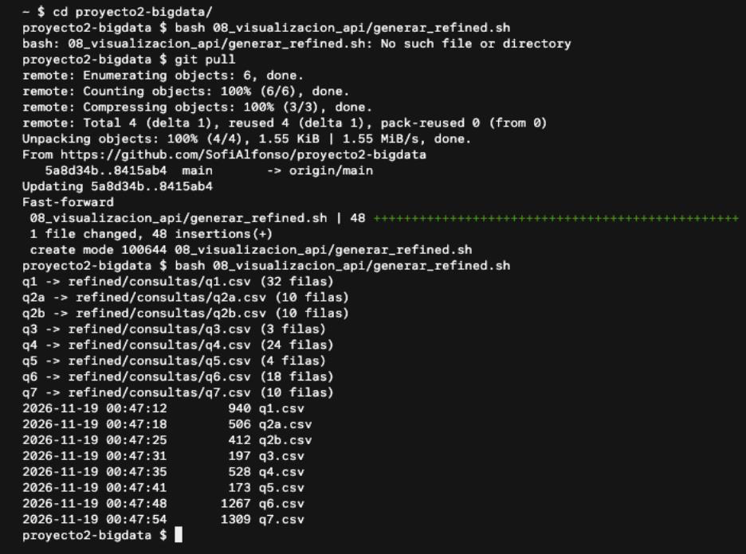
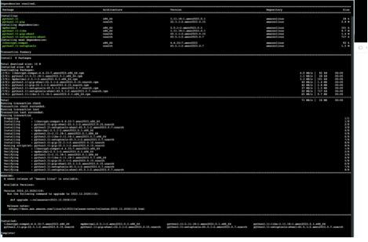
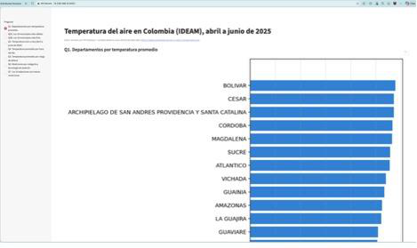
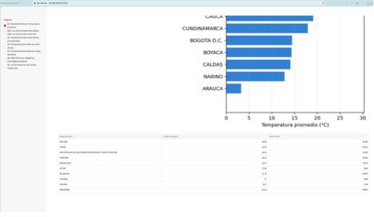
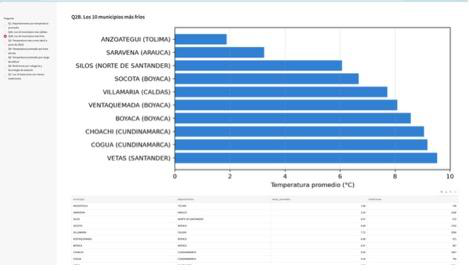
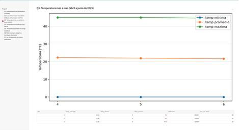
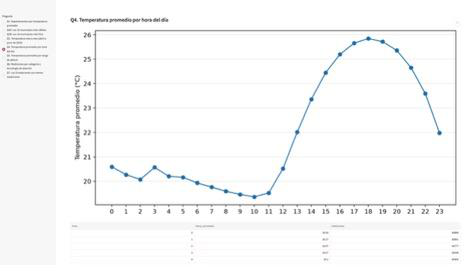
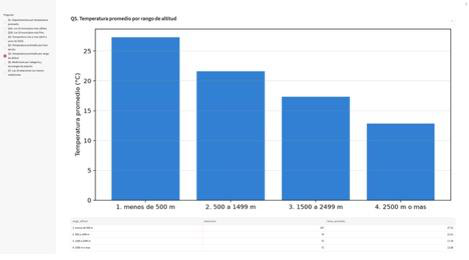
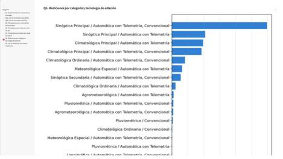
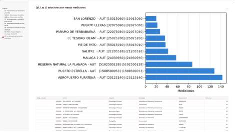

# Punto 8 – Visualización y API

**Objetivo:** una aplicación de visualización de datos (**Streamlit** con matplotlib) que consume una API expuesta con **API Gateway**.

## Cómo está armado

```
Athena ──► S3 refined/consultas/*.csv ──► Lambda "ideam-api" ──► API Gateway (HTTP API) ──► Streamlit (en la EC2)
```

| Paso | Archivo | Qué hace |
|---|---|---|
| 1 | `generar_refined.sh` | Ejecuta en Athena cada consulta de `06_consultas_sql/consultas.sql` y guarda el resultado en `s3://<BUCKET_NAME>/refined/consultas/<id>.csv` (q1, q2a, q2b, q3 a q7) |
| 2 | `crear_api.sh` + `lambda/lambda_function.py` | Crea la Lambda `ideam-api` (Python 3.12, rol `LabRole`) y la expone con un HTTP API de API Gateway; guarda la URL en `API_URL` de `.env` y prueba las rutas |
| 3 | `streamlit/iniciar_streamlit.sh` + `streamlit/app.py` | Instala Python 3.11 y Streamlit en la EC2 y deja la app corriendo en el puerto 8501 |
| 4 | `abrir_puerto_streamlit.sh` | Abre el puerto 8501 de la EC2 solo para tu IP e imprime la URL de la app |

## Cómo reproducir

```bash
# Desde la terminal del lab, con .env creado y las tablas de ideam_trusted ya catalogadas:
bash 08_visualizacion_api/generar_refined.sh
bash 08_visualizacion_api/crear_api.sh               # imprime API_URL

# En la EC2 (Session Manager), con el repo descargado:
bash 08_visualizacion_api/streamlit/iniciar_streamlit.sh <API_URL>

# De nuevo desde la terminal del lab (tu IP: https://checkip.amazonaws.com):
bash 08_visualizacion_api/abrir_puerto_streamlit.sh <tu-ip>
```

Abrir `http://<IP-de-la-EC2>:8501`.

## La API

| Ruta | Respuesta |
|---|---|
| `GET /consultas` | Ids de las consultas disponibles (`q1`, `q2a`, ...) |
| `GET /consultas/{id}` | Filas del CSV `refined/consultas/{id}.csv` en JSON |

La Lambda solo lee de la zona `refined/`: no consulta Athena en cada petición, así que responde rápido y no gasta en consultas. Valida el id con una expresión regular y devuelve 404 si no existe.

## La aplicación

La app pide a la API la lista de consultas y, según la que se elija en el panel izquierdo, grafica con matplotlib:

- Barras horizontales para rankings (Q1, Q2a, Q2b, Q6, Q7).
- Líneas para series (Q3 mes a mes con mínima, promedio y máxima; Q4 por hora).
- Barras verticales para la comparación por rango de altitud (Q5).

Bajo cada gráfica muestra la tabla de datos. Los resultados se guardan 5 minutos en caché (`st.cache_data`).

## Notas y limitaciones

- La Lambda convierte a número todo valor que parezca número, incluidos los códigos de estación: `0015015060` aparece como `15015060` en la gráfica de Q7. Es solo de presentación.
- `abrir_puerto_streamlit.sh` busca el grupo de seguridad `fuente-archivos-sg`, que crea `infra/01_red.sh`; si la EC2 se creó con otro grupo, hay que abrir el puerto 8501 a mano.
- El puerto 8501 queda abierto solo a la IP indicada, no a Internet.

## Evidencias

| Captura | Qué muestra |
|---|---|
|  | `generar_refined.sh`: 8 resultados guardados en `refined/consultas/` |
|  | Instalación de Python 3.11 y Streamlit en la EC2 |
|   | App: Q1, departamentos por temperatura |
|  | App: Q2b, municipios más fríos |
|  | App: Q3, mes a mes |
|  | App: Q4, por hora |
|  | App: Q5, altitud |
|  | App: Q6, categorías y tecnologías |
|  | App: Q7, estaciones con menos mediciones |

> Pendiente de capturar para completar este punto: la salida de `crear_api.sh` (URL de la API y las dos pruebas con `curl`) y la consola de API Gateway o de Lambda.
