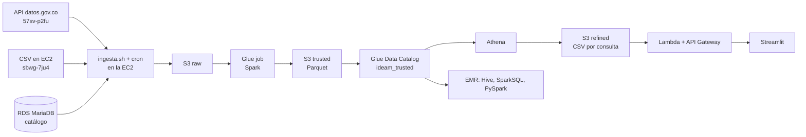

# Proyecto 2 – Big Data (EAFIT 2026-2)

SI3007 Sistemas Distribuidos · ST0263 Tópicos Especiales en Telemática

Pipeline de datos completo en AWS (Learner Lab) sobre la **temperatura del aire en Colombia** (IDEAM, datos.gov.co), con análisis de **abril a junio de 2025**: fuentes de datos, ingesta automática a un data lake en S3, limpieza con Glue y Spark, catalogación, consultas SQL (Athena, Hive y SparkSQL), PySpark y una aplicación Streamlit expuesta con API Gateway.

## Caso de estudio

Se quiere conocer cómo varía la temperatura en el país según el lugar, la altitud, el mes y la hora, y qué tan completa es la red de estaciones que la mide. Las preguntas de negocio son:

1. ¿Qué departamentos tienen la temperatura promedio más alta y más baja?
2. ¿Cuál fue el municipio más caliente y cuál el más frío?
3. ¿Cómo varía la temperatura promedio mes a mes (abril, mayo y junio de 2025)?
4. ¿Cómo cambia la temperatura a lo largo del día (por hora)?
5. ¿Qué relación hay entre la altitud de la estación y su temperatura promedio?
6. ¿Qué categorías o tecnologías de estación aportan más mediciones?
7. ¿Qué estaciones reportaron menos mediciones y qué características tienen (categoría, tecnología, departamento)?

Las respuestas, con los resultados obtenidos, están en [06_consultas_sql](06_consultas_sql/README.md#respuestas-a-las-preguntas-de-negocio).

## Datos (tres fuentes, tres formatos)

| Fuente | Dataset (datos.gov.co) | Dónde vive | Por qué ahí |
|---|---|---|---|
| **Base de datos** | Catálogo Nacional de Estaciones del IDEAM (`hp9r-jxuu`, 38.782 filas) | Tabla `estaciones` en **RDS MariaDB** | Dato de referencia, estable y con columnas fijas |
| **Archivos** | Temperatura Ambiente del Aire (`sbwg-7ju4`), abr–jun 2025, 1.453.127 filas | CSV de 251 MB en una **EC2** | Histórico grande que no cambia |
| **URL** | Datos de Estaciones de IDEAM y de Terceros (`57sv-p2fu`, ~160 mil filas) | **API** de datos.gov.co | Dato que cambia constantemente: se consulta en cada ingesta |

## Arquitectura



El data lake usa tres zonas: `raw/` (datos crudos tal como llegan), `trusted/` (limpios y en Parquet) y `refined/` (resultados de las consultas que sirve la API).

## Estructura del repositorio

| Carpeta | Punto de la guía | Contenido |
|---|---|---|
| [01_caso_estudio](01_caso_estudio/README.md) | 1 | Datasets, preguntas y decisiones del caso |
| [02_fuentes_datos](02_fuentes_datos/README.md) | 2 | RDS MariaDB, EC2 con archivos y URL; scripts de infraestructura |
| [03_ingesta_datalake](03_ingesta_datalake/README.md) | 3 | Bucket S3 con zonas e ingesta automática (cron) |
| [04_preparacion_glue_spark](04_preparacion_glue_spark/README.md) | 4 | Job de Glue con Spark: raw a trusted |
| [05_catalogacion](05_catalogacion/README.md) | 5 | Crawler de Glue y EMR/Hive |
| [06_consultas_sql](06_consultas_sql/README.md) | 6 | Consultas en Athena, Hive y SparkSQL, y respuestas |
| [07_pyspark](07_pyspark/README.md) | 7 | Las mismas consultas con PySpark |
| [08_visualizacion_api](08_visualizacion_api/README.md) | 8 | Zona refined, Lambda, API Gateway y Streamlit |

Cada carpeta trae su `README.md`, el código y una subcarpeta `evidencias/` con las capturas.

## Requisitos

- Cuenta de **AWS Academy Learner Lab** (rol `LabRole`, región `us-east-1`).
- Terminal del Learner Lab o **CloudShell** con AWS CLI, `git` y `python3`.
- Una EC2 a la que entrar con **Session Manager** (no hace falta llave SSH).

## Cómo reproducir todo el proyecto

Se ejecuta en orden; el README de cada carpeta detalla su paso.

```bash
# 0. Obtener el código y configurar
git clone https://github.com/SofiAlfonso/proyecto2-bigdata.git && cd proyecto2-bigdata
cp env.ejemplo .env && nano .env     # BUCKET_NAME (único en todo S3), RAMA=main, AWS_REGION=us-east-1

# 2. Fuentes de datos
bash 02_fuentes_datos/infra/01_red.sh
bash 02_fuentes_datos/infra/02_ec2.sh
bash 02_fuentes_datos/infra/03_rds.sh        # pide la clave maestra y muestra el endpoint
#    En la EC2 (Session Manager): crear ~/.my.cnf, descargar los datos y cargar el catálogo (ver 02_fuentes_datos)

# 3. Data lake e ingesta automática
bash 03_ingesta_datalake/crear_bucket.sh
#    En la EC2: bash ~/datos/programar_ingesta.sh

# 4. Raw a trusted (Glue + Spark)
bash 04_preparacion_glue_spark/crear_job_glue.sh

# 5. Catalogación
bash 05_catalogacion/crear_crawler.sh
bash 05_catalogacion/crear_emr.sh
bash 05_catalogacion/ejecutar_hive.sh 05_catalogacion/verificar_hive.hql

# 6. y 7. Consultas
bash 06_consultas_sql/ejecutar_emr.sh hive      06_consultas_sql/consultas.sql
bash 06_consultas_sql/ejecutar_emr.sh spark-sql 06_consultas_sql/consultas.sql
bash 06_consultas_sql/ejecutar_emr.sh pyspark   07_pyspark/consultas.py

# 8. Refined, API y aplicación
bash 08_visualizacion_api/generar_refined.sh
bash 08_visualizacion_api/crear_api.sh
#    En la EC2: iniciar_streamlit.sh <API_URL>; luego, desde la terminal del lab, abrir_puerto_streamlit.sh <tu-ip>
```

Los pasos 2 a 8 leen `BUCKET_NAME`, `AWS_REGION` y demás valores de `.env`; ningún script trae esos datos escritos. `.env` está en `.gitignore`.

## Costos y limpieza

- El clúster **EMR** es lo más caro (un nodo `m5.xlarge`, unos 0,25 USD por hora). Se apaga solo tras 1 hora sin uso. Al terminar: `source .env && aws emr terminate-clusters --cluster-ids "$EMR_CLUSTER_ID"`.
- Detener la **RDS** y la **EC2** (no terminarlas) cuando no se usen: el Learner Lab no las detiene por sí solo.
- S3, Glue (en reposo), Athena y Lambda cuestan centavos.

## Limitaciones conocidas de los datos

- El catálogo trae cada estación repetida 2 o 4 veces y con el código de 8 y de 10 dígitos; tras limpiar quedan 9.935 estaciones.
- La fuente no tiene datos para varios días de finales de mayo y principios de junio de 2025 (mayo tiene 20 días con datos y junio 28).
- La columna `hora` está en la hora de la fuente, que por la forma del ciclo diario parece ser UTC (Colombia es UTC-5).
- Algunos promedios por departamento salen de muy pocas estaciones (Arauca, por ejemplo, de una sola de alta montaña) y no representan al departamento completo.
- La API de datos recientes entrega una ventana móvil y no siempre se refresca entre corridas.

## Equipo

- Ana Sofia Alfonso Moncada
- Esteban Alvarez Zuluaga
- <<Nombre del integrante 3, si aplica>>
